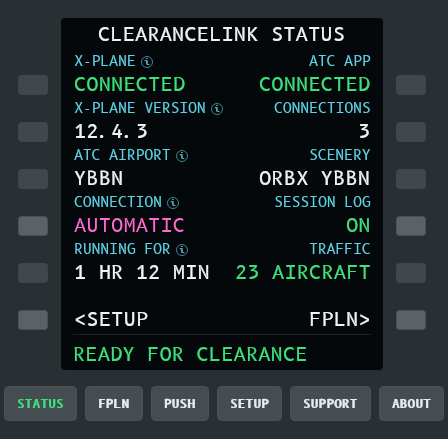

# ClearanceLink

**An experimental SimConnect to X-Plane 12 bridge.**
ClearanceLink stands in for MSFS and answers from X-Plane, so an ATC add-on made for MSFS can give you clearances, taxi
routes, SIDs, STARs, approaches, handoffs and traffic in X-Plane 12. You choose the app's .exe; ClearanceLink sets it
up to talk to X-Plane.

> Free, experimental hobby project by Nodeblue, with no warranty: a development proof of concept. It is not made,
> supported or endorsed by any developer whose app uses SimConnect, nor by Microsoft or Laminar Research. Please
> don't ask the developers of your ATC app for help with it.

## Get started
1. **[Download and install](docs/install.md)**: unzip, double-click `ClearanceLink.exe`. On its WELCOME pages you choose
   your ATC app's .exe, it finds X-Plane, installs the traffic plugin and shows the X-Plane settings to turn down.
2. **For traffic, add [FSLTL](https://fslivetrafficliveries.com/)** (free): the ATC app may need it for traffic, and
   ClearanceLink converts its aircraft for X-Plane on the TRAFFIC page. CSL models such as Bluebell or X-CSL (free)
   add more aircraft, but don't replace FSLTL.
   See [set up traffic, step by step](docs/help.md#set-up-traffic-step-by-step).
3. **Every flight**: plan it in SimBrief, start X-Plane 12 at the plan's departure airport, keep ClearanceLink open,
   then start your ATC app.
4. **Optional, for pushback**: install the free [Better Pushback](https://forums.x-plane.org/files/file/90556-better-pushback-for-x-plane-1112/) plugin (1.14 or later). The PUSH page then
   pushes you back when the ATC app clears you, like GSX in MSFS.

You need Windows 10 or 11, X-Plane 12.1.4 or later and an ATC app that uses SimConnect. MSFS doesn't need to be installed.

**[Help](docs/help.md)**: first start, every flight, X-Plane settings, aircraft models, flying MSFS as well, problems.

## For developers
C# on .NET 10 plus a small C++ X-Plane plugin. `./scripts/test.ps1` builds and tests, `./scripts/run.ps1 serve` runs
from source, `./scripts/publish.ps1` makes the zip. Where things stand: [docs/STATUS.md](docs/STATUS.md). How it fits
together: [docs/architecture.md](docs/architecture.md). Coding agents: [AGENTS.md](AGENTS.md).

## Licence
GPLv3, see [LICENSE](LICENSE), with an [added permission](LICENSE-EXCEPTION.txt) to link the X-Plane plugin with
X-Plane and its SDK. Libraries, the font and the X-Plane SDK parts in the release are under their own licences, listed
in [THIRD-PARTY-NOTICES.txt](packaging/THIRD-PARTY-NOTICES.txt). Test data under other terms
([X-Plane Scenery Gateway excerpts](tests/ClearanceLink.Airports.Tests/fixtures/README.md),
[MSFS recordings](recordings/samples/README.md)) is not part of the release.
