# ClearanceLink help

ClearanceLink lets [BeyondATC](https://www.beyondatc.net/), which is made for Microsoft Flight Simulator, work with
X-Plane 12. BeyondATC talks to ClearanceLink as if it were MSFS, and ClearanceLink answers from X-Plane.

> **Experimental.** ClearanceLink is a free hobby project by Nodeblue, with no warranty. It is not affiliated with,
> endorsed by or supported by BeyondATC, Microsoft or Laminar Research. Please don't ask BeyondATC's team for help
> with it.

**Contents:** [The window](#the-window) · [First start](#first-start) · [Every flight](#every-flight) · [Flight plans](#flight-plans) · [Pushback](#pushback) ·
[X-Plane settings](#x-plane-settings) · [Aircraft models for traffic](#aircraft-models-for-traffic) ·
[BeyondATC settings](#beyondatc-settings) · [Flying MSFS as well](#flying-msfs-as-well) · [What works](#what-works) ·
[Problems](#problems) · [Getting help](#getting-help) · [Commands](#commands)

Downloading, the Windows warning and updating are on [Download and install](install.md).

## The window
ClearanceLink looks like an aircraft's FMS. Each page has six rows; press the button beside a row, or click the row,
to do what it says. The keys under the screen change page. On the keyboard, 1 to 6 press the left buttons,
Shift+1 to 6 the right ones, and F1 to F6 change page (F5 is FPLN, F6 is PUSH).

| STATUS | FPLN | SETUP | SUPPORT |
|---|---|---|---|
|  | 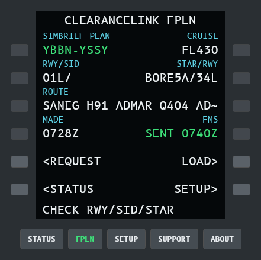 | 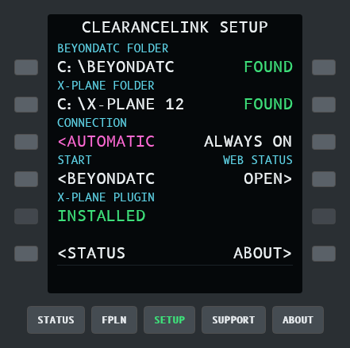 | 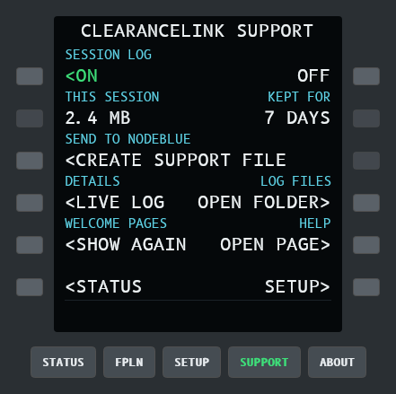 |

- **STATUS** shows what is connected. Its bottom line says what to do next, and **READY FOR CLEARANCE** when all is
  well.
- **FPLN** fetches your latest SimBrief plan and loads it into X-Plane's FMS when you ask. See
  [Flight plans](#flight-plans).
- **PUSH** pushes you back with the Better Pushback plugin when BeyondATC clears you. See [Pushback](#pushback).
- **SETUP** shows the BeyondATC and X-Plane folders and the connection mode, opens **TRAFFIC** (the X-Plane plugin,
  aircraft models and X-Plane settings) and the WELCOME pages, starts BeyondATC and
  opens a web page in your browser with the same status.
- **SUPPORT** makes a support file, shows the live log, and opens this help page.

Rest the mouse on the small **i** beside a row's name to see what the row means.
- **ABOUT** shows the version, and **NEW VERSION** when a newer release is out.

## First start
Double-click `ClearanceLink.exe`. The first time, six **WELCOME** pages take you through the set-up. Press **NEXT**
to go on, **BACK** to go back, or **SKIP** on the first page to skip them (SETUP > **WELCOME** brings them back).

| 1 Welcome | 2 Folders | 3 Traffic |
|---|---|---|
| 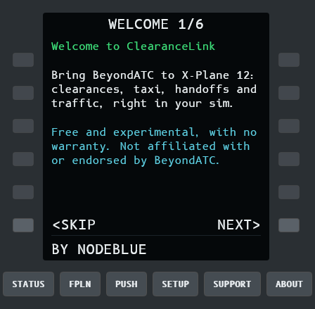 | 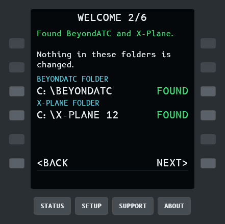 | 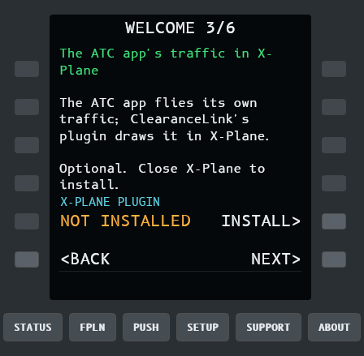 |

| 4 Aircraft models | 5 X-Plane settings | 6 Every flight |
|---|---|---|
| 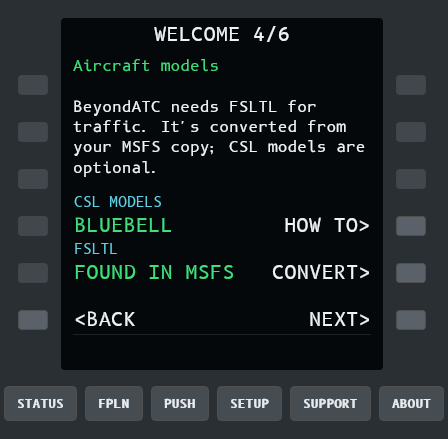 | 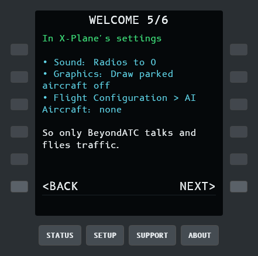 | 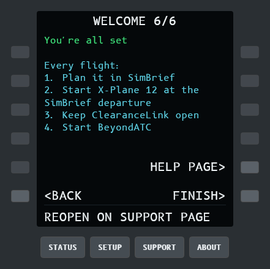 |

1. **Welcome.** What ClearanceLink is.
2. **Folders.** ClearanceLink finds BeyondATC and X-Plane by itself. If a line says **NOT FOUND**, press **CHOOSE**
   and pick the folder: the BeyondATC folder holds `BeyondATC.exe`, the X-Plane folder holds `X-Plane.exe`. Nothing
   in these folders is changed.
3. **BeyondATC's traffic.** BeyondATC creates and flies its own traffic. ClearanceLink's X-Plane plugin draws it in
   X-Plane. Close X-Plane, then press **INSTALL**. Traffic is optional: skip it and ATC still works.
4. **Aircraft models.** The plugin needs aircraft models to draw the traffic with. See
   [Aircraft models for traffic](#aircraft-models-for-traffic). You can come back to this later.
5. **X-Plane settings.** Three settings to turn down, explained [below](#x-plane-settings).
6. **Every flight.** The order to start things in. Press **FINISH**.

## Every flight
1. Plan your flight in [SimBrief](https://dispatch.simbrief.com/) and generate the flight plan. BeyondATC loads your
   latest SimBrief plan itself, the same as with MSFS. X-Plane's own flight plan isn't used.
2. Start X-Plane 12 and load your aircraft at the SimBrief departure airport, at a gate or parking spot.
3. Double-click `ClearanceLink.exe` and leave its window open.
4. Optional: on the **FPLN** page press **REQUEST**, check the plan, then press **LOAD** twice to put the same plan in
   X-Plane's FMS. See [Flight plans](#flight-plans).
5. Start BeyondATC and start your flight as usual.

The bottom line of STATUS says what to do next: **START X-PLANE 12**, **START BEYONDATC**, **CLOSE MSFS TO CONNECT**
(see [Flying MSFS as well](#flying-msfs-as-well)), and **READY FOR CLEARANCE** when everything is connected.

Start ClearanceLink before BeyondATC. If you close or restart ClearanceLink during a flight, restart BeyondATC too:
it doesn't reconnect by itself. When you've finished, close BeyondATC, then ClearanceLink.

## Flight plans
BeyondATC flies the plan you made in SimBrief, but X-Plane's FMS doesn't know about it. The **FPLN** page fetches
the same plan from SimBrief and puts it in X-Plane, so ATC and your FMS agree. Nothing happens until you press a key.


1. Make your plan in SimBrief and press Generate, as usual.
2. On **FPLN**, press **REQUEST**. The page shows the airports, cruise level, runways, SID and STAR, the route, and
   when SimBrief made the plan (**MADE**). Check it's the flight you mean.
3. Press **LOAD**. It turns into **CONFIRM**, because loading replaces the plan in the FMS; press it again within 10
   seconds. **FMS** then says **SENT** with the time.
4. Check the plan in the FMS, as you would any uplink.

ClearanceLink uses the SimBrief account you linked in BeyondATC, so there is nothing to set up. If FPLN says **NO
SIMBRIEF ID IN BEYONDATC**, link SimBrief in BeyondATC, or run `ClearanceLink.exe settings simbrief-id <your SimBrief
pilot ID>`.

**Same plan as BeyondATC.** Both fetch your latest SimBrief plan. If you change it in SimBrief, generate it again,
reload it in BeyondATC, then press REQUEST and LOAD again. REQUEST says **NO NEWER PLAN** when SimBrief has nothing
new.

**Aircraft with their own FMS.** LOAD also saves the plan as a file in `X-Plane 12\Output\FMS plans`, named after the
airports (for example `YBBNYSSY.fms`). Aircraft that don't use X-Plane's FMS (many add-on airliners) can load that
file from their own FMS menu. If the plugin isn't installed, LOAD only saves the file and the bottom line says which
name to load.

## Pushback
In MSFS, BeyondATC can call GSX for your pushback. X-Plane has no GSX, so the **PUSH** page does it with the free
[Better Pushback](https://forums.x-plane.org/files/file/90556-better-pushback-for-x-plane-1112/) plugin instead. It
follows BeyondATC's clearance, including "face east". Like GSX in MSFS, the tug comes as soon as BeyondATC approves
your pushback, and it only moves once you release the parking brake.

Install the maintained Better Pushback mod, version 1.14 or later, from [X-Plane.org](https://forums.x-plane.org/files/file/90556-better-pushback-for-x-plane-1112/) (free account
needed; source on [GitHub](https://github.com/olivierbutler/BetterPusbackMod)). Older Better Pushback versions lack the
commands ClearanceLink uses. Unzip it into `X-Plane 12\Resources\plugins` with X-Plane closed.

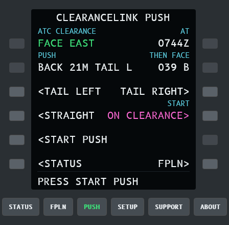

1. Ask BeyondATC for pushback as usual. When it approves, the PUSH page shows the clearance (**FACE EAST**) and the
   push it worked out: how far back, which way the tail goes, and the heading and taxiway you'll end up on.
   Better Pushback's tug comes to the aircraft.
2. When the bottom line says **RELEASE PARKING BRAKE**, release it. The tug pushes you back, turns and stops.
3. When it says **SET PARKING BRAKE**, set it. ClearanceLink tells the tug to disconnect for you.

- **TURN** pushes another way than ATC said. **TAIL LEFT** swings the tail left, so the nose ends up pointing
  right; **TAIL RIGHT** is the opposite; **NO TURN** pushes straight back. **AS ATC SAID** goes back to ATC's way.
  You can change it until the tug starts moving.
- **TUG AUTO** (the default) calls the tug when BeyondATC approves. **TUG MANUAL** waits for you to press
  **CALL TUG**; STATUS says **PUSHBACK APPROVED: PUSH** meanwhile.
- **STOP** ends the push where you are. The tug still disconnects once you set the parking brake.

ClearanceLink uses the taxiways in X-Plane's airport data to end a turning push on the taxiway behind you, lined up
with it. Where it finds none, it pushes back 15 m and turns. A push with no turn goes back about one aircraft
length (15 m for a small aircraft, about 40 m for a 737), worked out from the aircraft's wheelbase.

**BETTER PUSHBACK MISSING** means X-Plane doesn't have the plugin. Install it in `X-Plane 12\Resources\plugins` and
restart X-Plane. ClearanceLink sends nothing to X-Plane until it's there.

**NOT MOVING: PRESS STOP** means the tug is on and the brake has been off for 40 seconds, but the aircraft hasn't
moved. Better Pushback can't push some aircraft (in our tests, the Aerobask Phenom 300, even from Better Pushback's
own menu). Press **STOP**, then taxi out under your own power or use the aircraft's own pushback, if it has one.

## X-Plane settings
Change these in X-Plane, so only BeyondATC talks and only BeyondATC's traffic flies:

| Where in X-Plane | Setting | Why |
|---|---|---|
| Settings > Sound | **Radios** slider to 0 | Otherwise X-Plane's own controllers and ATIS talk over BeyondATC. |
| Settings > Graphics | **Draw parked aircraft** off | X-Plane would park its own aircraft at the gates where BeyondATC parks its traffic. |
| Flight Configuration > **AI Aircraft** | Remove all AI aircraft (the X beside each) | X-Plane's AI flies aircraft BeyondATC doesn't know about. |

ClearanceLink reads X-Plane through X-Plane's built-in Web API (port 8086), which is on by default. No X-Plane
setting needs changing for that.

## Aircraft models for traffic
BeyondATC's traffic (aircraft at gates, taxiing, departing and arriving) appears in X-Plane through ClearanceLink's
X-Plane plugin. The plugin draws each aircraft with a **CSL model**, the kind of aircraft model X-Plane's online
flying plugins use. X-Plane doesn't come with any.

**FSLTL is required for traffic.** BeyondATC only creates traffic when it finds FSLTL (or AIG or FS Traffic) on your
PC, because it picks each aircraft from FSLTL's list. Without it, BeyondATC says "No traffic liveries found" and
there is no traffic at all, not even on frequency. With MSFS 2024, FSLTL must be in MSFS 2024's Community folder.
Without MSFS 2024, choose the FSLTL folder on TRAFFIC; ClearanceLink shows it to BeyondATC while ClearanceLink is
open. ClearanceLink converts FSLTL's aircraft for X-Plane.

**CSL models (Bluebell, X-CSL) are optional.** They only change how the traffic looks, and fill in aircraft FSLTL
doesn't have. BeyondATC can't see them, so they don't replace FSLTL. You can have FSLTL, Bluebell and X-CSL together.

Everything for traffic is on the **TRAFFIC** page: press **SET UP** beside TRAFFIC on SETUP.

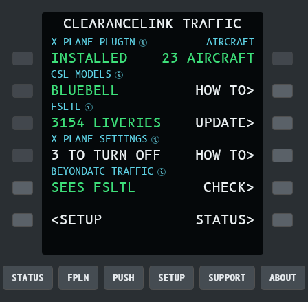

### CSL models: Bluebell and X-CSL (free downloads)
The **CSL MODELS** line on TRAFFIC names what ClearanceLink found (BLUEBELL, X-CSL, OTHER), or the number of packages
when the names don't fit. Restart X-Plane after adding models.

**Bluebell**
1. Download the **Bluebell OBJ8 CSL packages** from the X-Plane.org forums:
   [forums.x-plane.org/index.php?/files/file/37041-bluebell-obj8-csl-packages/](https://forums.x-plane.org/index.php?/files/file/37041-bluebell-obj8-csl-packages/)
   (a free X-Plane.org account is needed to download).
2. Unzip the packages into `X-Plane 12\Custom Data\CSL`, so you end up with folders like
   `X-Plane 12\Custom Data\CSL\BB_Airbus`. (Make the `CSL` folder if it isn't there. One extra folder level, such as
   `CSL\Bluebell\BB_Airbus`, also works.)

**X-CSL** (the models IVAO uses for X-Plane)
1. Download the **X-CSL Updater** from [x-csl.ru](https://x-csl.ru/downloads?lang_id=43) and run it.
2. Set its install folder to `X-Plane 12\Custom Data\CSL\X-CSL`, select all packages and update. It needs at least
   2.5 GB.
3. Run the updater again now and then to get new models and liveries.

### FSLTL (converted from your MSFS copy)
[FSLTL](https://fslivetrafficliveries.com/) (FS Live Traffic Liveries, free) is needed for BeyondATC's traffic, and
ClearanceLink converts its aircraft for X-Plane.
The conversion runs on your PC and reads your FSLTL folder only. FSLTL's licence doesn't allow sharing the models, so
the converted models stay on your PC: never upload or share them.
1. On TRAFFIC, the FSLTL line says **FOUND IN MSFS** when ClearanceLink finds the `fsltl-traffic-base` package
   in your MSFS Community folder (MSFS 2024 or 2020, Microsoft Store or Steam). If it says **NOT FOUND** or
   **NEEDS MSFS**, or shows liveries with **CHOOSE**, press **CHOOSE** and pick the `fsltl-traffic-base` folder yourself.
2. Close X-Plane and press **CONVERT**. It runs in the background and takes several minutes; LIVE LOG on SUPPORT shows
   progress. When it's done, the line shows how many liveries were converted (about 3,000) and the models take about
   13 GB.
3. The models go to `X-Plane 12\Custom Data\CSL\ClearanceLink-FSLTL`. After an FSLTL update, press **UPDATE** on TRAFFIC
   to convert again.

### FSLTL CHECK
Press **CHECK** on TRAFFIC's BEYONDATC TRAFFIC line to see what's in your FSLTL folder and what to do about it. The
bottom line says **FSLTL READY** when all is well, or the one thing to fix.

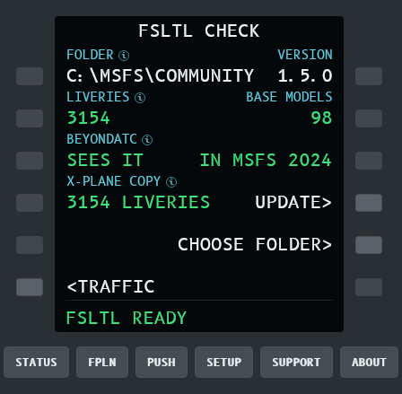

| Line | What it means |
|---|---|
| FOLDER, VERSION | Where your `fsltl-traffic-base` folder is, and FSLTL's version. CHOOSE FOLDER picks another. |
| LIVERIES, BASE MODELS | How many liveries the folder has, and the base aircraft models they use. Every livery needs its base model in the same folder. |
| BEYONDATC | **SEES IT IN MSFS 2024**: BeyondATC finds FSLTL itself. **SEES IT WHILE OPEN**: no MSFS 2024, so ClearanceLink shows BeyondATC your folder while it's open. **WON'T SEE IT**: BeyondATC makes no traffic (see Problems). |
| X-PLANE COPY | How many liveries are converted for X-Plane, with CONVERT or UPDATE. |

### How a model is picked
A converted FSLTL livery is an exact match, so it's always used when there is one. Other aircraft get the closest CSL
model and livery there is, from `Custom Data\CSL` and the CSL folders of LiveTraffic, xPilot, X-IvAp or swift; an
airline without a matching livery gets another livery of the same aircraft type.

The plugin lives in `X-Plane 12\Resources\plugins\ClearanceLink`. X-Plane locks it while running, so close X-Plane
before installing or updating it from SETUP.

## BeyondATC settings
Nothing needs changing. BeyondATC sees ClearanceLink as "MSFS 2024".
- Your SimBrief account is set in BeyondATC, as for MSFS. BeyondATC loads your latest SimBrief flight plan itself and
  takes only your position from X-Plane, so the plan's departure airport must be the one you're parked at. A plan
  without a SID in its route gets cleared with "radar vectors".
- BeyondATC's traffic setting works as in MSFS. The traffic appears in X-Plane once the plugin and
  [models](#aircraft-models-for-traffic) are installed.
- Use BeyondATC's own key bindings for push-to-talk and quick replies. Binding them inside X-Plane isn't supported
  yet.

## Flying MSFS as well
Nothing to switch. While ClearanceLink is open, it adds two small files (`SimConnect.cfg`) to BeyondATC's folder so
BeyondATC talks to X-Plane; SETUP says **BATC: X-PLANE TILL EXIT**. Closing ClearanceLink removes them, so BeyondATC
goes back to MSFS. Other apps that work with both sims, such as SPAD.neXt, never see a pretend MSFS.

To fly MSFS, close ClearanceLink and start MSFS. If MSFS starts while ClearanceLink is open, ClearanceLink steps aside:
BeyondATC goes to MSFS and STATUS says **CLOSE MSFS TO CONNECT**.

If you want MSFS open while flying X-Plane, choose **ALWAYS ON** on SETUP. The two files then stay in place even after
ClearanceLink closes, so BeyondATC always goes to ClearanceLink. Choose **AUTOMATIC** again before flying MSFS with
BeyondATC.

If BeyondATC is in a folder ClearanceLink can't write to (under Program Files, for example), ClearanceLink uses MSFS's
own connection instead, while MSFS is closed. Running ClearanceLink as administrator lets it use the files.

## What works
- Clearance, taxi routes on X-Plane's own taxiways, SIDs and STARs, frequencies with automatic COM tuning, handoffs,
  approaches, altitudes and flight levels.
- BeyondATC's traffic, drawn in X-Plane with CSL models.
- Airports whose X-Plane scenery has no taxiways get a simple generated taxi network.
- STATUS shows the airport BeyondATC is using and which scenery it came from.
- Pushback with Better Pushback, following BeyondATC's clearance (see [Pushback](#pushback)).

BeyondATC's other GSX services (boarding, refuelling) do nothing in X-Plane. Not yet: a few things BeyondATC asks
MSFS for that X-Plane has no equivalent of (those are ignored).

## Problems
| What you see | What to do |
|---|---|
| BeyondATC says "Flight Simulator is not running!" | Start ClearanceLink first, then BeyondATC. |
| STATUS says CLOSE MSFS TO CONNECT | Close MSFS, or choose ALWAYS ON on SETUP. |
| STATUS says START X-PLANE 12 with X-Plane open | Load an aircraft; X-Plane answers once a flight is loaded. Check X-Plane is 12.1.4 or later. |
| STATUS says X-PLANE NOT CONNECTED | BeyondATC is connected but X-Plane isn't. Start X-Plane and load a flight. |
| A folder says NOT FOUND | On SETUP (or WELCOME page 2), press CHOOSE beside it and pick the folder. |
| No traffic visible | On TRAFFIC (from SETUP), the X-PLANE PLUGIN must say INSTALLED and BEYONDATC TRAFFIC must say SEES FSLTL. Traffic must be on in BeyondATC. |
| TRAFFIC's BEYONDATC TRAFFIC says NO FSLTL (STATUS or SETUP: NO FSLTL) | BeyondATC won't find FSLTL, so it creates no traffic. See the next row. |
| BEYONDATC TRAFFIC says NOT IN MSFS 2024, with liveries converted | MSFS 2024 is on this PC but FSLTL isn't in its Community folder. BeyondATC only looks there, and ClearanceLink doesn't change MSFS 2024's files. Install FSLTL for MSFS 2024 (in its Community folder). The converted copy for X-Plane isn't enough: BeyondATC can't see it. |
| FSLTL says NO BASE MODELS, or FSLTL CHECK says LIVERIES BUT NO MODELS | The folder has FSLTL's liveries but not the base aircraft models they use, so nothing can be converted. Update or reinstall FSLTL Traffic Base with the FSLTL injector, then choose the folder again. |
| FSLTL CHECK says *n* LIVERIES: NO MODEL | Some liveries' base models are missing (a partly copied or updated FSLTL). The rest convert as usual; those aircraft are drawn with CSL models. Updating FSLTL usually fixes it. |
| BeyondATC says "No traffic liveries found" | BeyondATC needs FSLTL installed for MSFS. Without MSFS 2024: make sure TRAFFIC shows your FSLTL folder (press CHOOSE if not), then start ClearanceLink before BeyondATC. With MSFS 2024: install FSLTL for MSFS 2024. |
| TRAFFIC on STATUS says SEE SETUP | The plugin isn't installed or needs updating. Close X-Plane and press INSTALL or UPDATE on SETUP. |
| No traffic after updating ClearanceLink | Close X-Plane and press UPDATE beside X-PLANE PLUGIN on TRAFFIC (from SETUP): a new ClearanceLink needs its matching plugin. |
| STATUS shows FSLTL MODELS UPDATE>, or SETUP shows UPDATE MODELS | FSLTL or ClearanceLink's converter changed since the models were converted (0.7.3 adds their lights). Close X-Plane, open TRAFFIC and press UPDATE. Textures already converted are kept, so it is quicker than the first time. |
| Traffic has no lights at night | Converted FSLTL models before 0.7.3 have none: press UPDATE on TRAFFIC. Aircraft parked at a gate are dark because BeyondATC turns their lights off, as in MSFS. |
| FMS on FPLN says NOT TAKEN | X-Plane's FMS refused the plan (the reason is on the bottom line). Load the saved `.fms` file from the aircraft's own FMS menu instead. |
| Another X-Plane add-on (SPAD.neXt, for example) can't use UDP port 49707 | Windows has reserved a block of ports for Hyper-V. Rebooting usually moves it. To keep 49707 free, run in an admin command prompt: `net stop winnat`, then `netsh int ipv4 add excludedportrange protocol=udp startport=49707 numberofports=1`, then `net start winnat`. ClearanceLink's plugin picks a free port by itself. |
| X-Plane talks over BeyondATC | In X-Plane, Settings > Sound, set the Radios slider to 0. |
| OTHER ADD-ONS on STATUS shows a number | Other MSFS add-ons tried to connect while MSFS was closed. They are ignored; nothing to do. |
| BeyondATC can't find MSFS after ClearanceLink crashed or the PC lost power | Start ClearanceLink and close it again. That removes its files from BeyondATC's folder. |

## Getting help
On the SUPPORT page press **CREATE SUPPORT FILE**. It makes one zip of ClearanceLink's recent logs, BeyondATC's log and
the end of X-Plane's log, with your Windows user name blanked out, and shows it in Explorer. Send it with a few words
on what went wrong, on the [ClearanceLink GitHub page](https://github.com/Nodeblue/ClearanceLink/issues).

Logs are kept in `%LOCALAPPDATA%\ClearanceLink` for 7 days. You can turn the session log off on SUPPORT, and
**LIVE LOG** shows what ClearanceLink is doing right now.

## Commands
Everything also works from a command prompt in ClearanceLink's folder, for example in a batch file:

```
ClearanceLink.exe start          run in the command prompt instead of the window
ClearanceLink.exe settings       show or change the folders, connection and log settings
ClearanceLink.exe support        make the support zip
ClearanceLink.exe plugin status  is the X-Plane plugin installed? (also: plugin install, plugin remove)
ClearanceLink.exe fsltl import   convert the FSLTL models (also: fsltl status)
ClearanceLink.exe xplane-check   check ClearanceLink can read what it needs from a running X-Plane
ClearanceLink.exe simbrief       save your latest SimBrief plan in X-Plane's Output\FMS plans
ClearanceLink.exe update         check for a newer release
ClearanceLink.exe --help         all commands
```
